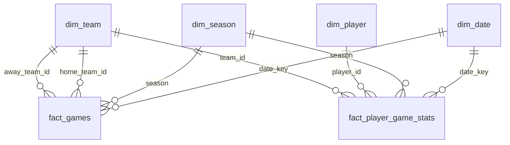

# Power BI

Conecte o Power BI ao MySQL e carregue apenas estas tabelas:

- `dim_date`
- `dim_season`
- `dim_team`
- `dim_player`
- `fact_games`
- `fact_player_game_stats`

Não carregue as tabelas de ingestão (`players`, `games` e `player_game_stats`),
pois elas são a camada bruta.

## Relacionamentos



Para `fact_games`, duplique a consulta `dim_team` no Power Query e chame as
cópias de `dim_home_team` e `dim_away_team`. Assim, crie dois relacionamentos
ativos, evitando relacionamentos bidirecionais ou inativos.

## Medidas iniciais

```DAX
Total Jogos = COUNTROWS(fact_games)

Pontos = SUM(fact_player_game_stats[points])

Jogos com Estatísticas = DISTINCTCOUNT(fact_player_game_stats[game_id])

Média de Pontos por Jogo =
DIVIDE([Pontos], [Jogos com Estatísticas])

Vitórias em Casa =
COUNTROWS(
    FILTER(
        fact_games,
        fact_games[winner_team_id] = fact_games[home_team_id]
    )
)
```

## Atualização

Após executar um pipeline de ingestão, atualize a camada analítica antes de
atualizar o relatório:

```powershell
python -m src.transform.build_star_schema
```
